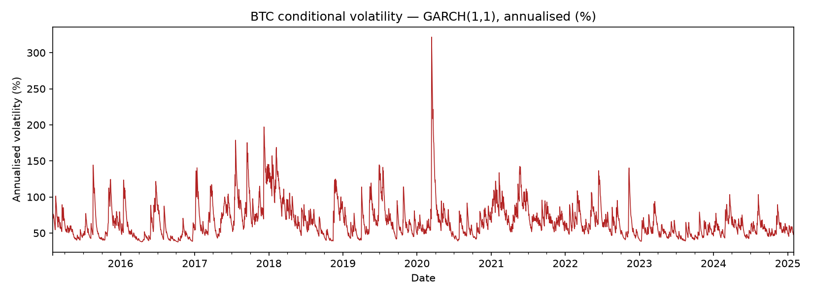

# GARCH(1,1) Volatility Replication — Bitcoin

Python replication of the volatility modelling from my BComHons Economics research project
(University of Johannesburg, 2025), originally estimated in EViews.

## Key results (daily BTC-USD, Feb 2015 – Jan 2025, n = 3,652)
- α = 0.125, β = 0.840 → persistence α + β = 0.965
- Shock half-life ≈ 19 days; long-run volatility ≈ 79% annualised
- Largest volatility spike: March 2020 (COVID crash)



## Run it
```bash
pip install -r requirements.txt
jupyter lab notebooks/01_btc_garch.ipynb
```

## Next steps
- Student-t errors for fat tails
- EGARCH / GJR-GARCH for asymmetric (leverage) effects
- Rolling out-of-sample volatility forecasts and VaR backtest